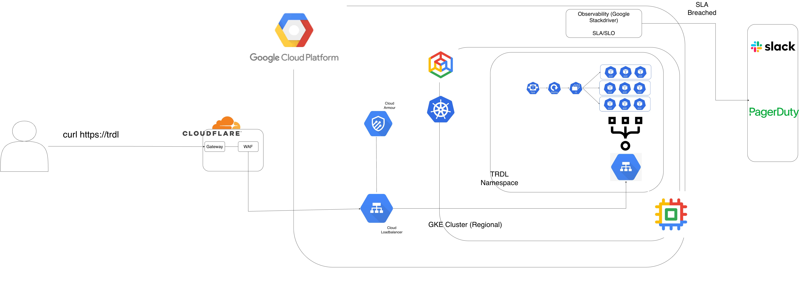

# The Responding Dark Laughter

TRDL is a web service that returns the value 42.

## Documentation

- [Discovery](discovery.md): requirements, design decisions, assumptions, and estimates.
- [Deployment](deployment.md): platform infrastructure and application deployment plans.

## Overview

The Responding Dark Laughter (TRDL) is a web service that returns the value 42.
It provides a simple, consistent response to its clients.

### Service Description

The service provides a web-based platform for users to manage and retrieve data through a highly available, resilient, and scalable architecture designed to meet a target SLA of several 9s.

### Goals
- High availability
- Horizontal scalability
- Fault tolerance
- Security and compliance
- Operational excellence

# Requirements

## Functional Requirements

Service provides REST API.

### User Capabilities
- CRUD operations

## Non-Functional Requirements

### Availability
- SLA Target: 99.9999%

### Scalability
- Support 250 requests/sec
- Scale horizontally

### Performance
- API latency P95 < 50 ms
- P99 latency < 100 ms

### Reliability
- No single point of failure
- Automatic failover

### Security
- Authentication (Out of Scope for now)
- Authorization (Out of Scope for now)
- DoS Protection using (Cloudflare WAF)
- Bot Detection (Cloudflare)

---

# High Level Architecture

Clients send HTTP requests to Cloudflare, which provides the gateway and WAF. The WAF detects bots and applies a rate limit of 10 requests per second per IP to help mitigate denial-of-service attacks.

Cloudflare forwards permitted traffic to a Google Cloud load balancer. A Cloud Armor policy allows traffic from Cloudflare IP ranges and blocks other sources. Because these ranges are shared by Cloudflare customers, IP allowlisting alone does not authenticate a particular Cloudflare account; origin authentication should also be configured.

The load balancer routes requests through a Kubernetes Service to the TRDL Deployment in a regional GKE cluster. The Deployment runs at least three replicas, and an HPA adjusts the replica count using a custom metric other than CPU or memory. The metric, target, and maximum replica count are to be determined. A Pod Disruption Budget limits voluntary disruptions. When pods cannot be scheduled due to insufficient capacity, the cluster autoscaler can add nodes based on their resource requests.
