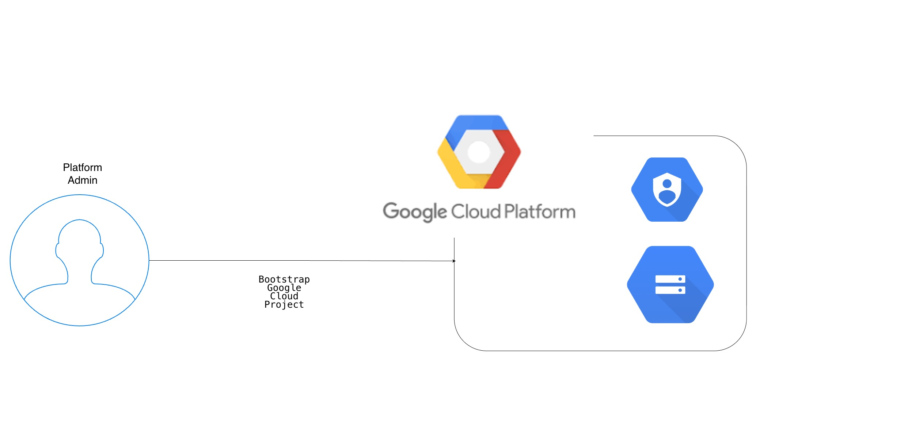
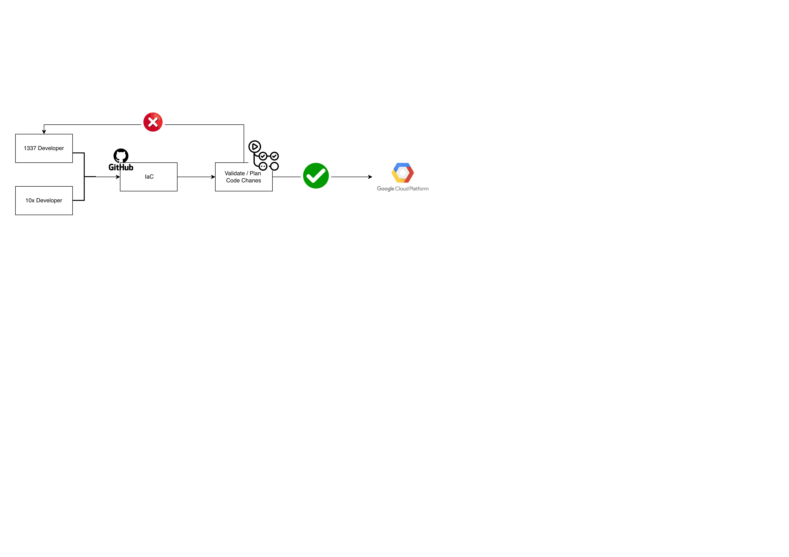
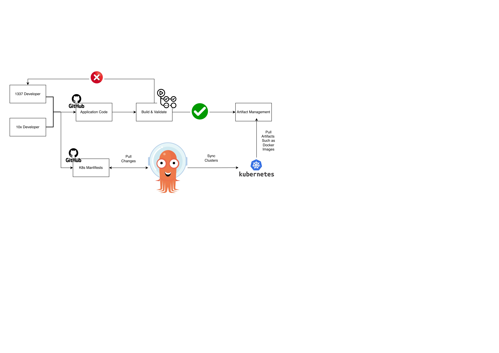

# Deployment and automation plan

Deployment is divided between platform engineers, who provision the infrastructure, and application engineers, who deliver TRDL onto that platform. This document describes the intended process; Terraform resources and GitHub Actions workflows are not yet ready to deploy the PoC.

## 1. Platform infrastructure

Platform administrators/engineers own the Google Cloud project, infrastructure configuration, and the automation that applies it. Infrastructure is declared with Terraform in the `terraform/` directory and applied by GitHub Actions.

### Bootstrap the project

An administrator authenticates with the Google Cloud CLI as a project owner and runs the one-time bootstrap command:



```sh
make bootstrap PROJECT_ID=my-project-id REPOSITORY=my-github-owner/my-repository
```

Use the Google Cloud project ID and the GitHub repository's `owner/name`. The command enables required APIs and sets up the workload identity pool, GitHub OIDC provider, service account, and IAM bindings needed to begin integrating GitHub Actions with the project. It prints the provider resource name and service account email for the workflow configuration. No long-lived service account key is needed.

The bootstrap should grant only the permissions needed for the initial integration; the permissions required to provision infrastructure must be determined and granted deliberately. The current target is not yet a verified minimal bootstrap: its service account ID contains underscores, which Google Cloud does not permit, and it grants Project IAM Admin and Service Account Admin. Configures cloud storage backend required for terraform backend. Its provider restriction covers one repository at a time; changing the repository affects the previous one.

### Declare and apply infrastructure

1. Platform engineers declare the required Google Cloud resources in `terraform/`, including the regional GKE cluster, networking, registry, and load-balancing components. Cloudflare and Cloud Armor configuration remain subject to the PoC scope decision.
2. Google Cloud storage is used as backend for terraform.
3. Configure GitHub Actions to authenticate through the bootstrapped workload identity provider and service account. Grant the identity the resource-specific permissions needed for Terraform and protect the repository, workflow, and deployment environment.
4. On proposed infrastructure changes, run Terraform formatting, validation, and plan in GitHub Actions. Review the plan before applying changes from an approved branch or environment.
5. Apply the reviewed changes through GitHub Actions from `terraform/`, then verify the resulting infrastructure and record the outputs needed for application deployment. Document recovery, teardown, and ongoing costs as the implementation is completed.



## 2. Application deployment



Application engineers own the TRDL application, its container image, Helm chart, and application manifests. Platform engineers provide Argo CD on GKE and configure access to the application manifests repository and Google Cloud Artifact Registry. The following is the intended GitOps workflow; the application pipelines and Argo CD configuration still need to be implemented.

1. **Build and test:** Developers submit application changes for review. CI runs automated tests, builds the container image, and packages and validates the Helm chart.
2. **Publish artifacts:** After the required checks pass, CI publishes the versioned image and Helm chart to Artifact Registry. Use an immutable image digest and a specific chart version to make releases reproducible.
3. **Declare the release:** Developers update the GitHub repository containing application manifests through a reviewed change. The desired configuration references the chart version, image digest, environment-specific values, and any additional Kubernetes resources. It includes the Deployment, Service, HPA, Pod Disruption Budget, resource requests, and health probes needed by TRDL.
4. **Reconcile:** Argo CD reads the approved desired state from the manifests repository, retrieves the referenced chart from Artifact Registry, and applies the resulting resources to GKE. Configure an Argo CD Application to use the chart and Git-hosted values or manifests as sources. CI publishes artifacts and updates Git; it does not deploy directly to the cluster.
5. **Verify:** Check the Argo CD sync and application health status, wait for the Deployment rollout and healthy backends, and run a smoke test confirming that public `GET /` returns `42`. Investigate and report failed syncs, unhealthy pods, or failed smoke tests.
6. **Roll back:** Revert the release change in the manifests repository to the previously working chart version, image digest, and configuration. Let Argo CD reconcile the reverted state, then verify the rollout and endpoint again.

CI needs permission to publish artifacts and propose manifest changes. Argo CD needs read access to the manifests repository and Helm chart, and permission to reconcile the application's Kubernetes resources. GKE needs permission to pull the container image. Use separate, least-privilege identities and keep credentials out of Git. Configure repository protections, Argo CD sync and approval policies, and access to private artifacts before enabling deployment.

The repository names, artifact paths, environment promotion process, and sync policy remain to be defined. See the developer contract in [discovery.md](discovery.md) for application behaviors required by the platform.
